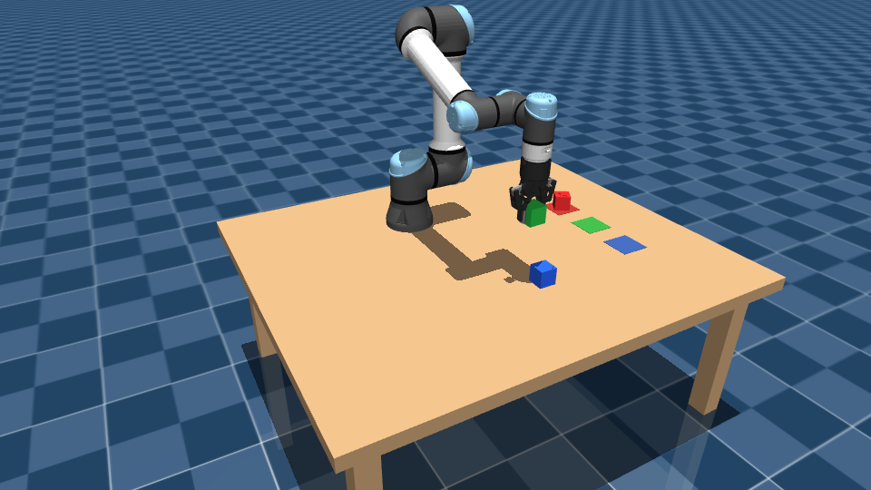

# MuJoCo Studio for Claude Code

Ask Claude for a robot simulation and get a link to watch it.

> "Create a MuJoCo scene of a UR5e picking and placing three cubes of different
> colours, and give me the link to visualize it."



Claude writes the scene in Python, tests it without a display, and serves it in
the MuJoCo Studio web viewer. Edit a file and the running simulation reloads.

This is an unofficial adapter. The viewer and most of the robotics know-how
come from Google DeepMind's open-source
[robotics plugin](https://github.com/google-deepmind/robotics-antigravity-plugin)
and [MuJoCo](https://github.com/google-deepmind/mujoco), which were written for
Google Antigravity. This plugin supplies the parts Claude Code needs to use
them: a helper script, starter templates and a skill that says which upstream
instructions apply. It is not affiliated with Google or Anthropic.

## Requirements

- Claude Code
- Linux, or Windows through WSL 2. macOS and native Windows are untested.
- `git`, `curl`, `bash` and Python 3.11 or newer. [`uv`](https://docs.astral.sh/uv/) is used if present.
- For pictures in headless tests: a GPU with EGL. Without one, set `MUJOCO_GL=osmesa`.

## Install

In Claude Code:

```
/plugin marketplace add alexandrosnic/mujoco-studio-claude
/plugin install mujoco-studio@mujoco-studio-claude
```

The first time you ask for a MuJoCo scene, Claude runs the one-off setup. It
downloads about 260 MB:

| What | Where |
|---|---|
| `mujoco` 4.0.1 or newer and `pillow`, in their own Python environment | `~/.venvs/mujoco-studio` |
| Google's robotics plugin, and Menagerie robots as they are used | `~/.local/share/mujoco-studio` |
| Viewer state and log | `~/.local/state/mujoco-studio` |

## Use

Ask for a scene in plain words. Some prompts to start from:

- "Create a MuJoCo scene of a Franka Panda pushing a ball off a table and give me the link."
- "Make the cubes twice as heavy and show me whether the gripper still holds them."
- "Add a slider for the arm speed."

Claude replies with a local address such as `http://localhost:8080/`. Open it
in a browser, or in VS Code with **Simple Browser: Show** from the command
palette to keep it beside your code.

Each scene is a folder you keep:

| File | Purpose |
|---|---|
| `scene.py` | The scene and its controller. No viewer imports, so it runs headless. |
| `test_scene.py` | Steps the simulation and asserts the outcome you asked for. |
| `sim_plugin.py`, `viewer_plugin.py`, `messages.py` | Wiring to the live viewer and its panel. |

## Try the example without Claude

```bash
git clone https://github.com/alexandrosnic/mujoco-studio-claude
cd mujoco-studio-claude
studio="bash skills/mujoco-studio/scripts/studio.sh"

$studio setup
bash examples/ur5e-pick-place/fetch_assets.sh
(cd examples/ur5e-pick-place && $studio python test_scene.py)
$studio start examples/ur5e-pick-place
```

The test should print `PASS: all three cubes placed`, and `start` prints the
viewer address. Stop the viewer with `$studio stop`.

## Helper commands

`bash skills/mujoco-studio/scripts/studio.sh <command>`

| Command | What it does |
|---|---|
| `setup [--update]` | Install or update MuJoCo and Google's plugin. |
| `new DIR` | Create a scene folder from the starter templates. |
| `start DIR [PORT]` | Serve the scene in `DIR` and print the address. Replaces a running viewer. |
| `status` | Report whether the last save reloaded cleanly, with the traceback if not. |
| `context` | Print the live joint positions and speeds as JSON. |
| `url`, `stop` | Print the viewer address; stop the viewer. |
| `python ARGS` | Run the environment's Python with offscreen rendering enabled. |
| `menagerie NAME...` | Fetch robot folders from MuJoCo Menagerie and print their paths. |
| `paths` | Print where the upstream skills are installed. |

## Limits

- **MuJoCo only.** Gazebo, Isaac Sim and other simulators are out of scope.
- **One viewer at a time.** Starting a scene replaces the one being shown.
- **No password on the viewer.** It listens on all network interfaces, so
  anyone who can reach the port can see it. Take care on shared networks.
- **Claude cannot see the browser.** It checks scenes through headless tests
  and the viewer's state, and says so in its reply.
- **Tracks upstream.** The helper calls Google's `studiod.py`. If its options
  change, run `setup --update` and open an issue here.
- Upstream skills for real robots and for perception with Gemini models are
  installed but untested with this plugin. The perception ones need a
  `GEMINI_API_KEY`.

## Licence and credits

Apache-2.0; see [LICENSE](LICENSE). The plugin downloads, and does not
redistribute, Google DeepMind's
[robotics plugin](https://github.com/google-deepmind/robotics-antigravity-plugin),
[MuJoCo](https://github.com/google-deepmind/mujoco) and
[MuJoCo Menagerie](https://github.com/google-deepmind/mujoco_menagerie) models,
each under its own licence. The starter templates follow the structure of the
upstream Studio scaffold.
